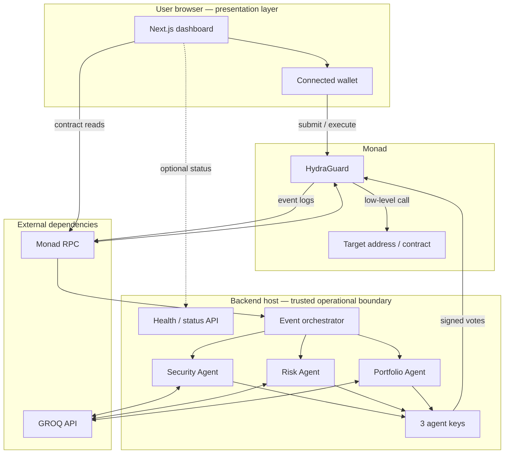
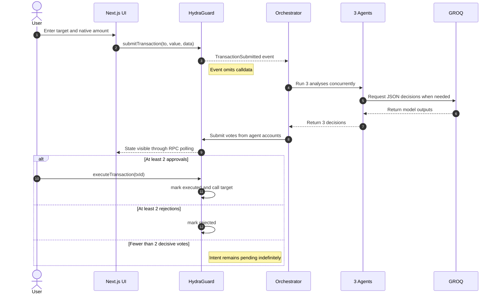
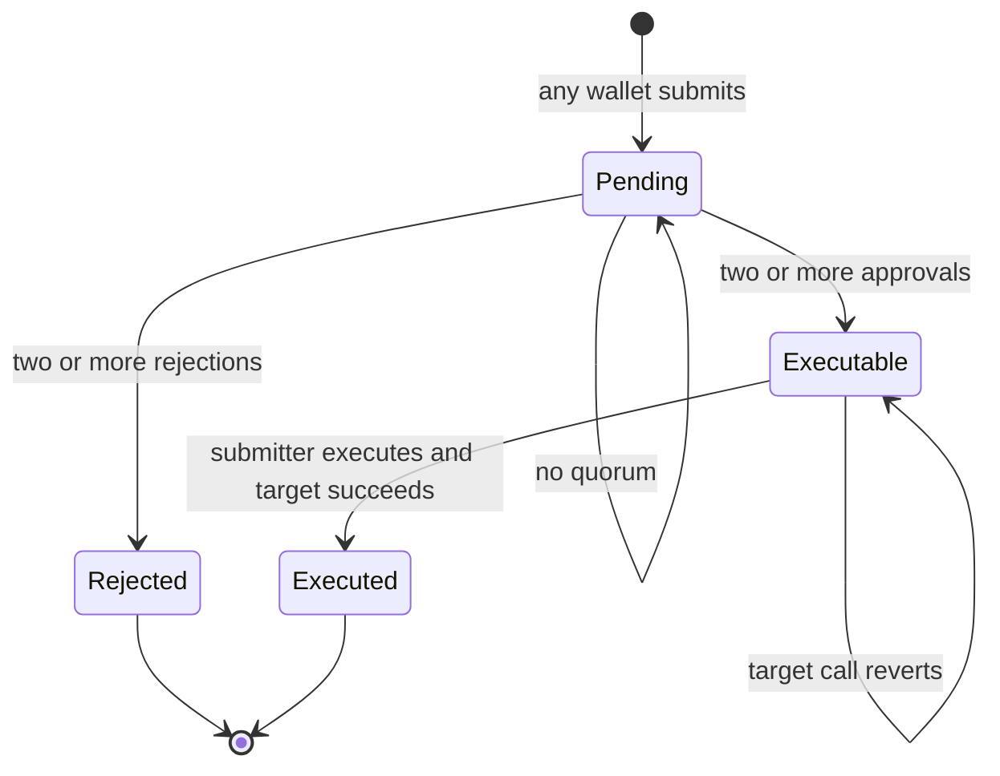

# HYDRA Architecture

This document is the technical source of truth for the current HYDRA repository.
It explains what the system does today, where its trust boundaries are, which
claims the implementation can support, and what must change before production use.

> [!NOTE]
> HYDRA is a testnet prototype, not an audited custody product. This document
> describes repository behavior; it does not make a security guarantee.

## Contents

- [System at a glance](#system-at-a-glance)
- [Trust model](#trust-model)
- [Transaction lifecycle](#transaction-lifecycle)
- [On-chain architecture](#on-chain-architecture)
- [Backend architecture](#backend-architecture)
- [Agent behavior](#agent-behavior)
- [Frontend architecture](#frontend-architecture)
- [Parallelism: precise claim](#parallelism-precise-claim)
- [Deployment and configuration](#deployment-and-configuration)
- [Operations and observability](#operations-and-observability)
- [Security and reliability register](#security-and-reliability-register)
- [Testing strategy](#testing-strategy)
- [Recommended evolution path](#recommended-evolution-path)

## System at a glance

HYDRA is a permissionless transaction relay with an AI-assisted authorization
gate. Any wallet can propose a transaction and, after approval, execute its own
proposal with its own MON. Three configured agent accounts review each proposal
and cast on-chain votes. The contract requires two approvals before execution and
permanently rejects a proposal after two rejections.

| Layer | Responsibility | Authority |
| --- | --- | --- |
| `HydraGuard` contract | Store intents and votes, enforce identity and quorum, execute calls | Final on-chain authority |
| Backend orchestrator | Observe submissions, run analyses, sign and broadcast votes | Controls the three configured agent keys |
| Next.js frontend | Connect any wallet, submit intents, read state, request execution | Convenience client; not trusted for enforcement |

### System boundary



The key separation is between **recommendation** and **enforcement**: agent logic
runs off-chain, while identity, quorum, and execution rules live in Solidity.

## Trust model

### What the contract guarantees

Assuming correct EVM execution and uncompromised keys, the contract enforces:

- Any address can submit an intent; only its submitter can execute it after quorum.
- Only a configured agent address can vote.
- Each configured address can vote once per transaction ID.
- Risk scores above 100 are rejected.
- Execution requires at least two recorded approvals.
- Two recorded rejections permanently block an intent.
- A successfully executed intent cannot execute again.
- If the external target call reverts, the whole execution reverts and the intent
  remains executable.

### What the complete system additionally trusts

- The backend host must protect all three agent private keys.
- Backend, frontend, and constructor addresses must match.
- The RPC must deliver timely logs, reads, and receipts.
- The orchestrator must be online when submissions arrive.
- GROQ output and deterministic rules must reflect the intended policy.
- Each submitting or executing user must verify the network, target, value, and action before signing.

All three agent keys currently live in one process. The agents are logically
specialized, but they are not independent infrastructure trust domains. A backend
host compromise can compromise the complete voting quorum.

### Current non-goals

- Per-user isolated custody or human multisig compatibility
- Agent rotation, key recovery, or on-chain governance
- Transaction expiry or cancellation
- Upgradeability or gas sponsorship
- Full portfolio accounting
- Transaction simulation
- Production-grade threat intelligence

## Transaction lifecycle

### End-to-end sequence



### Derived transaction states

The contract does not store a state enum. State is derived from booleans and vote
counts.



There is no terminal state for an abandoned pending intent. Missing votes leave it
pending forever.

### Approval path

1. All three analyses finish before vote submission starts.
2. If fewer than two analyses reject, all three votes are broadcast concurrently
   with `Promise.all`.
3. Each wallet has an independent account and nonce stream.
4. After two approvals, `canExecute(txId)` becomes true.
5. The submitter sends the separate payable execution transaction.

The third agent may still vote after approval quorum because quorum does not mark
the intent resolved.

### Rejection path

1. If two or more analyses reject, votes are submitted sequentially.
2. The orchestrator waits for each receipt before sending the next vote.
3. The second recorded rejection sets `rejected = true`.
4. Later votes revert through `notExecuted`.

This reduces expected reverts, but current error handling treats every submission
error as resolution. A transient RPC error can stop the loop prematurely.

## On-chain architecture

### Contract role

`contracts/src/HydraGuard.sol` is a payable execution relay and intent registry
with a 2-of-3 authorization gate.

After quorum, execution uses:

```solidity
(bool success,) = txn.to.call{value: txn.value}(txn.data);
require(success, "HydraGuard: execution failed");
```

This supports native transfers and arbitrary contract calls. The current frontend
submits native transfers with `data = 0x`, but the contract interface is more
general.

### Roles

| Role | Stored as | Capabilities |
| --- | --- | --- |
| User / executor | `msg.sender` and per-intent `submittedBy` | Submit intents and execute their own approved intents |
| Agent | `address[3] public agents` and `isAgent` | Vote once per intent |
| Target | Per-transaction `to` | Receive native value and/or calldata |

The constructor rejects zero addresses but does not require the three agents to be
distinct. Duplicate addresses can make quorum unreachable.

### Storage model

```solidity
address[3] public agents;
uint256 public txCount;
uint256 public constant THRESHOLD = 2;

mapping(uint256 => Transaction) public transactions;
mapping(uint256 => mapping(address => Vote)) public votes;
mapping(address => uint256) public agentReputation;
mapping(address => bool) public isAgent;
```

`Transaction` stores:

| Field | Meaning |
| --- | --- |
| `to` | Execution target |
| `value` | Native MON forwarded during execution |
| `data` | Arbitrary calldata forwarded during execution |
| `executed` | Successful execution marker |
| `rejected` | Permanent rejection marker |
| `approvalCount` | Recorded approval total |
| `rejectionCount` | Recorded rejection total |
| `submittedAt` | Submission block timestamp |
| `submittedBy` | Wallet that created the intent |

`Vote` stores:

| Field | Meaning |
| --- | --- |
| `hasVoted` | Double-vote guard |
| `approve` | Agent decision |
| `reason` | On-chain human-readable explanation |
| `riskScore` | Integer from 0 to 100 |
| `timestamp` | Vote block timestamp |

Reasons are permanently public. They must never contain secrets, credentials,
private user context, or sensitive model traces.

### Contract interface

| Function | Caller | Effect |
| --- | --- | --- |
| `submitTransaction(to, value, data)` | Anyone | Creates intent and increments `txCount` |
| `agentVote(txId, approve, reason, riskScore)` | Agent | Stores vote and updates tallies |
| `executeTransaction(txId)` | Submitter | Executes an approved intent with exact `msg.value` |
| `getTransaction(txId)` | Anyone | Returns target, value, flags, and counts |
| `getVote(txId, agent)` | Anyone | Returns an agent's vote |
| `getAgents()` | Anyone | Returns configured agents |
| `canExecute(txId)` | Anyone | Returns derived execution eligibility |

### Events

| Event | Main consumer | Notes |
| --- | --- | --- |
| `TransactionSubmitted` | Orchestrator | Carries ID, target, value, submitter; omits calldata |
| `AgentVoted` | UI and indexers | Carries public vote result |
| `TransactionExecuted` | UI and indexers | Marks successful execution |
| `TransactionRejected` | UI and indexers | Emitted when the second rejection lands |

### Calldata visibility gap

The contract stores `Transaction.data`, but the submission event omits it and the
custom `getTransaction` view does not return it. The backend ABI exposes no other
getter for the field.

The orchestrator evaluates `log.args.data || '0x'`, so normal event-driven
analysis always receives `0x`. Risk selector checks and LLM calldata reasoning are
therefore inactive.

Two direct corrections are possible:

- add `bytes data` to `TransactionSubmitted`; or
- add `getTransactionData(txId)` and read it before analysis.

The event approach simplifies indexing but increases log size. The view approach
adds one RPC call per intent.

### Value custody and execution

Submitting an intent does not deposit MON. During execution, the original
submitter must send exactly the approved value as `msg.value`. HydraGuard forwards
that value to the target in the same transaction:

- HydraGuard does not hold user value between submission and execution;
- another wallet cannot execute someone else's intent;
- an incorrect value reverts before the external call;
- target failure rolls back `executed = true` and returns the value; and
- the submitter can retry after fixing the failure condition.

### Reputation semantics

`agentReputation[agent]` increments on every approval. It is an approval counter,
not a correctness or accuracy score, and it has no effect on voting power.

## Backend architecture

### Process composition

`backend/index.js` starts an HTTP status server and the blockchain event watcher
in one Node.js process.

`backend/lib/viemClient.js` creates:

- one public client for reads, logs, and receipts; and
- three wallet clients, one for each agent key.

Separate accounts avoid nonce contention between agents. They do not remove
on-chain storage conflicts.

### Startup configuration

Required values:

- `AGENT1_KEY`
- `AGENT2_KEY`
- `AGENT3_KEY`
- `CONTRACT_ADDRESS`

`GROQ_API_KEY` is optional only in mock mode.

Wallets are constructed during module import, before the friendly environment
validation in `index.js`. A missing agent key may therefore throw before the
intended validation message appears.

### Event consumption

The orchestrator polls `TransactionSubmitted` every two seconds. Per log, it:

1. Extracts `txId`, `to`, and `value`.
2. Defaults missing calldata to `0x`.
3. Runs all analyses concurrently.
4. Chooses parallel or sequential vote submission.
5. Waits up to 15 seconds for each receipt.
6. Appends a summary to a 100-entry in-memory activity log.

There is no persistent cursor, backfill, queue, dead-letter store, or explicit
reorg handling. The application does not replay events missed during downtime.

### Vote submission

Before broadcasting, the orchestrator:

- clamps and rounds `risk_score` to 0–100;
- truncates `reason` to 200 characters; and
- approves only when `result.approve === true`.

The current catch block maps all failures—resolved transaction, RPC timeout,
insufficient gas, invalid configuration, or another error—to `resolved: true`.
The sequential rejection loop stops when it sees that flag.

Activity summaries are calculated from model decisions, not reconciled receipts.
`/status` can therefore disagree with on-chain state.

### Status API

| Route | Response |
| --- | --- |
| `GET /health` | Process status and uptime |
| `GET /status` | Uptime, contract, retained activity count, last 20 entries |
| Other | JSON 404 |

CORS allows every origin. Activity is capped at 100 process-local entries and
disappears on restart, so `totalProcessed` is not a lifetime counter. The API is
informational and never authorizes frontend actions.

## Agent behavior

All agents return:

```json
{
  "approve": true,
  "reason": "Short human-readable explanation",
  "risk_score": 18
}
```

There is no shared runtime schema validator. JSON parsing is enforced, but field
types and semantic consistency are only partially normalized before voting.

### Common decision order

1. Check the shared two-address demo blacklist.
2. Run agent-specific deterministic checks.
3. In mock mode, return a predefined safe response.
4. Otherwise send a low-temperature, JSON-constrained prompt to GROQ.
5. On model or parsing error, return the predefined safe response.

Step 5 is demo-oriented fail-open behavior. A production engine should fail
closed, abstain, or require explicit manual review.

### Security Agent

| Capability | Current implementation |
| --- | --- |
| Demo blacklist | Deterministic |
| Scam association | LLM reasoning only |
| Calldata review | Prompt-based, but receives `0x` through the current event path |
| Bytecode inspection | Not implemented |
| Contract verification | Not implemented despite demo response wording |
| Threat-feed lookup | Not implemented |

### Risk Agent

Deterministic rejection rules:

- target appears in the shared demo blacklist;
- value exceeds `1000 MON`;
- calldata begins with `0x095ea7b3`, the `approve` selector; or
- calldata begins with `0x2e1a7d4d`, a common `withdraw` selector.

The selector checks do not activate through the normal event path today. The agent
does not simulate calls, inspect pool liquidity, or observe the mempool.

### Portfolio Agent

The agent fetches the native balance of HydraGuard and calculates:

```text
positionPct = transactionValue / hydraGuardNativeBalance × 100
```

It rejects values above 50%. This is a real RPC read but not a complete portfolio:

- it measures the submitting wallet that must fund execution;
- it excludes tokens, NFTs, LP positions, lending positions, and debt; and
- if the balance read fails, analysis continues without reliable balance context.

### Shared demo blacklist

```text
0x000000000000000000000000000000000000dead
0xdeaddeaddeaddeaddeaddeaddeaddeaddeaddead
```

This exists for deterministic demos. It is not a threat-intelligence database.

## Frontend architecture

### Composition

```text
RootLayout
└── Providers
    ├── WagmiProvider
    ├── QueryClientProvider
    └── RainbowKitProvider
        └── Home
            ├── ConnectWallet / WrongNetworkBanner
            ├── TransactionForm
            ├── AgentPanel
            │   ├── 3 × AgentCard
            │   └── ParallelProof
            ├── TransactionHistory
            ├── AgentReputation
            └── OrchestratorStatus
```

### Submission tracking

The form writes `submitTransaction(to, value, 0x)`. After confirmation, it decodes
`TransactionSubmitted` from that transaction's receipt and passes the exact
`txId` into the agent panel. Concurrent submissions therefore cannot redirect the
UI to another user's latest intent.

### Authoritative reads

`AgentPanel` reads contract state directly:

- `getTransaction(txId)` every three seconds;
- `getVote(txId, agent)` every second for all agents.

Presentation delays stagger the cards, but results come from the chain.

`TransactionHistory` displays the latest ten intents for every connected user.
The same data remains publicly readable from the contract.

`AgentReputation` polls approval counters every five seconds and renders relative
bars.

### Network and status behavior

The configured chain ID is `10143`. On another network, the UI automatically
requests a switch and can request adding the configured network.

If `NEXT_PUBLIC_BACKEND_URL` is set, the UI polls `GET /status` every 30 seconds.
Reachability does not prove that the watcher is synchronized, wallets are funded,
GROQ is available, or votes can be mined.

### Same-block display

`ParallelProof` queries `AgentVoted` logs and compares block numbers. Two current
edge cases matter:

- JavaScript `every(...)` is true for a one-element list and can also be true for
  two matching logs; and
- the copy says “All 3 votes” without verifying exactly three logs exist.

Even with three logs, this proves same-block inclusion—not concurrent EVM
execution.

## Parallelism: precise claim

| Property | Current status | Evidence |
| --- | --- | --- |
| Concurrent analysis | Yes | Three promises run together |
| Concurrent broadcast | Yes on approval-majority path | Three writes start without awaiting each other |
| Same-block inclusion | Observable, not guaranteed | Vote receipts can share a block |
| Conflict-free EVM execution | Not established | Storage access includes shared writes |

Each agent writes an independent vote entry:

```text
votes[txId][agent1]
votes[txId][agent2]
votes[txId][agent3]
```

But approvals also update shared `transactions[txId].approvalCount` and rejections
update shared `transactions[txId].rejectionCount`. All votes read shared status.
The current design therefore cannot accurately claim “zero contention.”

If conflict-free voting is a core requirement, record only per-agent votes during
`agentVote` and derive or materialize the tally in a separate resolution step.
That tradeoff needs fresh gas, latency, and UX measurements.

## Deployment and configuration

One deployment consists of one immutable HydraGuard, three agents, one continuously
running backend, one frontend deployment, and one or more RPC endpoints. Changing
agents currently requires redeployment.

### Configuration ownership

| Value | Contract deployment | Backend | Frontend |
| --- | ---: | ---: | ---: |
| Contract address | Output | Required | Required |
| Agent public addresses | Required | Derived from keys | Required |
| Agent private keys | Never | Required | Never |
| RPC URL | Deployment input | Optional override | Chain config |
| GROQ key | Never | Required outside mock mode | Never |
| WalletConnect ID | Never | Never | Required |
| Backend URL | Never | Server binding | Optional public URL |

### Backend environment

```dotenv
AGENT1_KEY=0x...
AGENT2_KEY=0x...
AGENT3_KEY=0x...
CONTRACT_ADDRESS=0x...
GROQ_API_KEY=gsk_...
USE_MOCK_AGENTS=false

RPC_URL=https://testnet-rpc.monad.xyz
PORT=3001
```

### Frontend environment

```dotenv
NEXT_PUBLIC_WALLETCONNECT_ID=...
NEXT_PUBLIC_APP_URL=https://your-deployment.example
NEXT_PUBLIC_MONAD_RPC_URL=https://testnet-rpc.monad.xyz
NEXT_PUBLIC_CONTRACT_ADDRESS=0x...
NEXT_PUBLIC_AGENT1_ADDRESS=0x...
NEXT_PUBLIC_AGENT2_ADDRESS=0x...
NEXT_PUBLIC_AGENT3_ADDRESS=0x...
NEXT_PUBLIC_BACKEND_URL=http://localhost:3001
```

All `NEXT_PUBLIC_*` values are shipped to browsers and must never contain secrets.

### Deployment invariants

Before starting the backend:

1. `getAgents()` returns three distinct expected addresses.
2. Each backend key derives to the corresponding contract agent.
3. Frontend addresses use the same agents and ordering.
4. Every agent has gas for multiple votes.
5. Every component uses the same chain and contract.

## Operations and observability

### Available signals

| Signal | Location | Persistence |
| --- | --- | --- |
| Analysis and vote logs | Backend stdout | Needs external collection |
| Process uptime | `/health` and `/status` | Process lifetime |
| Recent activity | `/status` | Last 100 entries in memory |
| Canonical votes and status | Contract state and events | On-chain |
| Vote block numbers | `AgentVoted` logs | On-chain |

The blockchain is canonical. Backend activity is diagnostic until reconciled with
receipts and state.

### Pending-transaction runbook

1. Check `GET /health` and backend stdout.
2. Read `getTransaction(txId)` and all three `getVote` results.
3. Verify agent balances and key/address alignment.
4. Inspect RPC errors and vote receipts.
5. Confirm the original submission event was observed.
6. Do not infer chain state from `/status` alone.

### Recovery characteristics

| Failure | Current recovery |
| --- | --- |
| Backend restart | New events are watched; missed events need manual handling |
| GROQ unavailable | Agents approve through the safe fallback |
| Vote RPC timeout | Logged; no durable automatic retry |
| Agent out of gas | Vote does not land; fund and handle manually |
| Agent key compromised | No rotation; redeploy |
| Intent abandoned | No cancel or expiry |

## Security and reliability register

Severity is an engineering priority for this prototype, not a formal audit rating.

| Priority | Risk | Current effect | Recommended change |
| --- | --- | --- | --- |
| Critical | External-analysis failure is fail-open | GROQ or JSON errors approve | Fail closed, abstain, or require manual override |
| Critical | Three agent keys share one host | One compromise can control quorum | Separate services/operators and HSM-backed keys |
| High | Event omits calldata | Selector and calldata analysis see `0x` | Emit or fetch exact calldata |
| High | No durable event replay | Downtime can leave intents pending | Persist cursor, backfill logs, use idempotent jobs |
| High | Errors treated as resolution | Transient failure can skip votes | Classify errors and verify state before stopping |
| High | Off-chain result reported as final | Status can disagree with chain | Derive summaries from landed receipts and reads |
| High | Known dependency advisories | Vulnerable package paths remain | Upgrade, retest, and audit lockfiles continuously |
| High | Permissionless submission spam | Attackers can create intents and drain agent gas | Require a bond, rate limit, or allowlisted relayer |
| Medium | Duplicate agents allowed | Quorum can be unreachable | Require pairwise-distinct constructor agents |
| Medium | No cancellation or expiry | Pending intents live forever | Add deadlines and governed cancellation |
| Medium | No simulation | Reverting or malicious calls may be approved | Simulate from HydraGuard and inspect state diff |
| Medium | Shared vote counters | Zero-contention claim is inaccurate | Separate recording from tally resolution |
| Medium | Same-block copy overstates evidence | Fewer than three logs can show proof | Require three logs and use precise wording |
| Low | Status API allows all origins | Operational metadata is public | Restrict deployed origins |
| Low | Approval counter called reputation | UI can imply unmeasured quality | Rename or implement outcome-based scoring |

Production controls should also include an external contract audit, secret manager
or HSM signing, RPC failover, metrics and alerts, rate limiting, policy versioning,
and a privacy review for public vote reasons.

## Testing strategy

### Existing coverage

`contracts/test/HydraGuard.t.sol` covers successful submission, counter increments,
access control, double-vote prevention, 2-of-3 execution, two-rejection resolution,
insufficient approvals, approval counters, agent reads, and native funding.

`contracts/test/Counter.t.sol` is Foundry starter coverage and is unrelated to
HYDRA.

The latest local review completed with 15 passing Foundry tests and a successful
Next.js production build.

### Highest-value missing tests

Contract:

- zero targets, invalid IDs, and risk scores above 100;
- duplicate constructor agents;
- failed target calls and retry behavior;
- reentrancy attempts;
- arbitrary calldata and token calls;
- all vote-order permutations;
- invariant: `executed` and `rejected` are never both true; and
- invariant: tallies equal stored votes.

Backend:

- exact calldata decoding after the event interface is fixed;
- malformed and adversarial model responses;
- fail-closed behavior;
- receipt timeout and retry classification;
- restart/backfill and duplicate-event idempotency; and
- partial vote landing with chain reconciliation.

Frontend:

- malformed or missing submission events in confirmed receipts;
- missing environment values and wrong-network handling;
- two-vote rejection rendering;
- exactly-three-log same-block messaging; and
- execution revert and retry UX.

### Recommended CI gates

```text
contracts: forge fmt --check → forge test -vv → invariant/fuzz suite
backend:   lint → unit tests → integration tests on a local chain
frontend:  lint/typecheck → component tests → next build
security:  dependency audit → secret scan → Solidity static analysis
```

## Recommended evolution path

### Phase 1 — Make the prototype internally correct

1. Expose exact calldata to the orchestrator.
2. Fail closed on analysis and parsing errors.
3. Validate three distinct agents.
4. Reconcile vote outcomes from chain state.
5. Correct same-block copy and require three logs.
6. Update vulnerable dependencies.

### Phase 2 — Make orchestration reliable

1. Persist a block cursor and backfill missed events.
2. Introduce one idempotent job per `chainId:contract:txId`.
3. Store analyses, attempts, hashes, and receipts durably.
4. Add retries, dead-letter handling, and alerts.
5. Separate agent signers into independent security boundaries.

### Phase 3 — Make analysis evidence-based

1. Simulate every transaction from HydraGuard.
2. Resolve target bytecode, proxy implementation, verification, and labels.
3. Decode calldata from verified ABIs where possible.
4. Integrate live threat intelligence and protocol-specific rules.
5. Model user assets and liabilities.
6. Record policy/model versions and evidence hashes.

### Phase 4 — Harden custody

1. Add deadlines, cancellation, pause, and recovery.
2. Design secure agent rotation and emergency governance.
3. Evaluate conflict-free vote storage and explicit resolution.
4. Add formal invariants, economic analysis, and external audit.
5. Deploy only after monitored testnet and adversarial exercises.

## Design decisions

### Why votes are on-chain

On-chain votes make identity, ordering, reasons, scores, and quorum independently
auditable. The tradeoff is gas cost, public metadata, and slower recovery from
operational errors.

### Why execution is submitter-triggered after quorum

Agent quorum is the policy boundary, while `submittedBy` binds payment and final
execution to the wallet that created the intent. Every user can complete their own
flow without gaining access to another user's funds. The tradeoff is that approval
does not guarantee execution and conditions can change before the submitter acts.

### Why deterministic rules run first

Deterministic checks are fast, repeatable, cheap, and testable. They give demos
stable behavior when an external model is unavailable. Their limitation is
coverage: a two-address blacklist and static thresholds are examples, not a
general security policy.

### Why the frontend reads the contract

Direct reads keep the backend from becoming the source of truth for approval
status. The tradeoff is RPC polling volume and eventual UI latency.

## Repository reference

```text
contracts/
├── src/HydraGuard.sol          Core wallet and voting contract
├── script/Deploy.s.sol         Environment-driven deployment
├── test/HydraGuard.t.sol       Product contract tests
└── foundry.toml                Compiler and Monad RPC configuration

backend/
├── index.js                    Status server, validation, startup
├── orchestrator.js             Event processing and vote coordination
├── agents/                     Security, risk, and portfolio analysis
├── lib/                        Contract ABI and viem clients
└── config/monad.js             Chain definition

frontend/
├── app/                        Next.js entry points
├── components/                 Wallet, transaction, agent, and status UI
├── hooks/useHydraContract.ts   Contract reads and writes
├── hooks/useAgentStatus.ts     Event-based helper
└── lib/                        ABI, addresses, and wagmi configuration
```

## Version reference

| Component | Repository version |
| --- | --- |
| Solidity | `0.8.24` |
| Next.js | `14.2.35` |
| React | `18.x` |
| wagmi | `^2.12.0` |
| RainbowKit | `^2.1.6` |
| viem | `^2.21.0` |
| GROQ SDK | `^0.7.0` |
| Tailwind CSS | `^3.4.1` |

Dependency ranges and lockfiles remain the authoritative install record.

---

For setup and the shortest path to a running demo, return to the
**[project README](README.md#quick-start)**.
