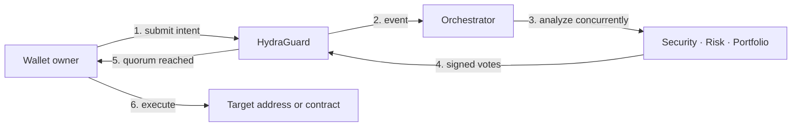

<p align="center">
  
</p>

<h1 align="center">HYDRA</h1>

<p align="center">
  <strong>Three AI guardians. One on-chain quorum. No execution without consensus.</strong>
</p>

<p align="center">
  An AI-native transaction security layer built on Monad.
</p>

<p align="center">
  <a href="#how-it-works">How it works</a> ·
  <a href="#quick-start">Quick start</a> ·
  <a href="ARCHITECTURE.md">Architecture</a> ·
  <a href="#security-posture">Security posture</a>
</p>

> **A wallet should not execute first and explain later. HYDRA evaluates first,
> reaches consensus on-chain, and only then unlocks execution.**

HYDRA transforms transaction approval from a single wallet click into a
programmable security process. Every submitted intent is examined by three
specialized agents—**Security**, **Risk**, and **Portfolio**—before funds are
allowed to move.

Each agent analyzes the transaction independently, signs its own decision, and
publishes that vote on-chain. The `HydraGuard` smart contract accepts exactly one
vote from each configured agent and requires a **2-of-3 quorum**. Two approvals
unlock execution. Two rejections permanently block the intent. Neither the
frontend nor the backend can bypass those rules.

This creates a clear division of power:

- **AI evaluates** the target, transfer risk, and portfolio impact.
- **Independent agent accounts attest** to their decisions with signed transactions.
- **Solidity enforces** identity, vote uniqueness, quorum, and execution safety.
- **The owner retains final control** by explicitly executing an approved intent.
- **The chain preserves the evidence**—decision, reason, score, timestamp, and result.

The result is more than an AI prompt attached to a wallet. HYDRA is a transparent
authorization architecture where off-chain intelligence produces recommendations
and deterministic on-chain rules decide whether execution is possible.

| Core property | HYDRA model |
| --- | --- |
| Authorization | 2-of-3 agent quorum enforced by `HydraGuard` |
| Decision engines | Security, Risk, and Portfolio agents |
| Evidence | Signed votes and human-readable reasons stored on-chain |
| Execution | Explicitly triggered by the owner after approval |
| Failure outcome | Two rejections make the intent non-executable |
| Runtime design | Concurrent analysis with independently submitted votes |

## From blind signing to policy-enforced execution

Most wallets ask a user one question: _did you sign?_ HYDRA adds a second layer:
_does this transaction satisfy the wallet's policy?_

The current prototype expresses that policy through three specialized agents:

| Agent | Deterministic checks | AI-assisted review |
| --- | --- | --- |
| Security | Two-address demo blacklist | Scam, phishing, and suspicious-call reasoning |
| Risk | Static value ceiling and selected function selectors | Transaction and DeFi risk reasoning |
| Portfolio | Native-balance concentration threshold | Position-size and concentration reasoning |

Every vote is an on-chain transaction. The Solidity contract—not the UI or the
LLM—enforces agent identity, one vote per agent, and the 2-of-3 execution
threshold.

## How it works



1. The owner submits `to`, `value`, and optional calldata to `HydraGuard`.
2. The contract stores the intent and emits `TransactionSubmitted`.
3. The backend runs all three analyses concurrently with `Promise.all`.
4. Three independently funded agent accounts submit `agentVote(...)` calls.
5. Two rejections permanently block the intent; two approvals make it executable.
6. The owner explicitly executes an approved intent.

HYDRA separates **analysis** from **enforcement**: agents can recommend, but only
the contract can establish quorum and release funds.

For storage layout, trust boundaries, state transitions, failure behavior, and
known implementation gaps, read the **[complete architecture guide](ARCHITECTURE.md)**.

## What is real in this prototype

- On-chain transaction intents, votes, quorum checks, and execution.
- Three distinct signing accounts with isolated nonces.
- Concurrent agent analysis and concurrent vote broadcasting on the approval path.
- A real native-balance read in the Portfolio Agent.
- Deterministic rejection scenarios for repeatable demos.
- A frontend that reads contract state rather than trusting backend output.
- A small status API for orchestrator health and recent in-memory activity.

## What is deliberately limited

- AI analysis is prompt-based; agents do not fetch bytecode, simulate calls, or
  consult a live threat-intelligence feed.
- If GROQ fails, the current demo fallback approves. This is fail-open behavior
  and is unsuitable for production.
- `TransactionSubmitted` does not currently include calldata, so the orchestrator
  receives `0x` for event-driven analysis. See the architecture guide for the
  recommended correction.
- Vote transactions may land in the same block, but same-block inclusion does not
  prove parallel EVM execution. Vote tally counters are shared storage writes.
- The Portfolio Agent compares against `OWNER_ADDRESS` native balance, not the
  HydraGuard contract balance or a complete token/DeFi portfolio.
- There is no on-chain expiry, cancellation, agent rotation, or upgrade mechanism.

## Repository map

```text
hydra/
├── contracts/               # Solidity contract, deployment script, Foundry tests
│   ├── src/HydraGuard.sol
│   ├── script/Deploy.s.sol
│   └── test/HydraGuard.t.sol
├── backend/                 # Event watcher, agents, vote submission, status API
│   ├── agents/
│   ├── lib/
│   ├── index.js
│   └── orchestrator.js
├── frontend/                # Next.js dashboard and wallet experience
│   ├── app/
│   ├── components/
│   ├── hooks/
│   └── lib/
├── ARCHITECTURE.md          # Technical source of truth
└── README.md
```

## Tech stack

| Layer | Technology |
| --- | --- |
| Contract | Solidity 0.8.24, Foundry |
| Network configuration | Monad Testnet, chain ID `10143` |
| Backend | Node.js ESM, viem, GROQ SDK |
| Frontend | Next.js 14 App Router, React 18, TypeScript |
| Wallet layer | wagmi, viem, RainbowKit |
| Styling | Tailwind CSS |

## Quick start

### Prerequisites

- Node.js 18 or newer
- npm
- [Foundry](https://book.getfoundry.sh/getting-started/installation)
- Four testnet accounts: one owner and three agents
- Testnet MON for deployment and agent gas
- A WalletConnect project ID
- A GROQ API key, unless mock mode is enabled

### 1. Install dependencies

```bash
git clone <repository-url>
cd hydra

cd contracts && forge install && cd ..
cd backend && npm ci && cd ..
cd frontend && npm ci && cd ..
```

### 2. Test the contract

```bash
cd contracts
forge test -vv
cd ..
```

### 3. Deploy HydraGuard

Create `contracts/.env` or export the following values in your shell:

```dotenv
DEPLOYER_KEY=<deployer-private-key-as-uint>
OWNER_ADDRESS=0x...
AGENT1_ADDRESS=0x...
AGENT2_ADDRESS=0x...
AGENT3_ADDRESS=0x...
```

Deploy with the included Foundry script:

```bash
cd contracts
source .env
forge script script/Deploy.s.sol:Deploy \
  --rpc-url monad_testnet \
  --broadcast
cd ..
```

Record the deployed contract address. Fund that address with enough MON to cover
the transfers used in your demo, and fund each agent account for gas.

### 4. Configure the backend

```bash
cp backend/.env.example backend/.env
```

```dotenv
AGENT1_KEY=0x...
AGENT2_KEY=0x...
AGENT3_KEY=0x...
CONTRACT_ADDRESS=0x...
OWNER_ADDRESS=0x...
GROQ_API_KEY=gsk_...
USE_MOCK_AGENTS=false

# Optional
RPC_URL=https://testnet-rpc.monad.xyz
PORT=3001
```

Set `USE_MOCK_AGENTS=true` for deterministic demo responses without GROQ. The
blacklist and agent-specific deterministic checks still run before mock mode.

### 5. Configure the frontend

Create `frontend/.env.local`:

```dotenv
NEXT_PUBLIC_WALLETCONNECT_ID=...
NEXT_PUBLIC_APP_URL=http://localhost:3000
NEXT_PUBLIC_MONAD_RPC_URL=https://testnet-rpc.monad.xyz
NEXT_PUBLIC_CONTRACT_ADDRESS=0x...
NEXT_PUBLIC_AGENT1_ADDRESS=0x...
NEXT_PUBLIC_AGENT2_ADDRESS=0x...
NEXT_PUBLIC_AGENT3_ADDRESS=0x...
NEXT_PUBLIC_BACKEND_URL=http://localhost:3001
```

The three public agent addresses must correspond exactly to the three private keys
used by the backend and the addresses passed to the contract constructor.

### 6. Run the stack

Terminal 1:

```bash
cd backend
npm start
```

Terminal 2:

```bash
cd frontend
npm run dev
```

Open [http://localhost:3000](http://localhost:3000), connect the owner wallet,
and switch to the configured Monad testnet.

For production, set `NEXT_PUBLIC_APP_URL` to the exact deployed origin and add
that same origin to the WalletConnect/Reown project domain allowlist.

### 7. Confirm health

```bash
curl http://localhost:3001/health
curl http://localhost:3001/status
```

The backend must remain online to observe new submission events and publish votes.
It does not replay missed events after a restart.

## Demo paths

| Scenario | Input | Expected behavior |
| --- | --- | --- |
| Small native transfer | Valid address and a small amount | Quorum normally approves; owner can execute |
| Known demo scam | `0x000000000000000000000000000000000000dEaD` | All deterministic blacklist checks reject |
| Large transfer | More than `1000 MON` | Risk Agent rejects |
| Concentrated transfer | More than 50% of configured owner balance | Portfolio Agent rejects |
| Insufficient contract funds | Approved amount exceeds HydraGuard balance | Execution reverts; intent remains unexecuted |

## Useful commands

```bash
# Contract tests
cd contracts && forge test -vv

# Frontend development
cd frontend && npm run dev

# Frontend production check
cd frontend && npm run build

# Backend with file watching
cd backend && npm run dev
```

## Backend status API

| Route | Purpose |
| --- | --- |
| `GET /health` | Process status and uptime |
| `GET /status` | Contract address, uptime, retained activity count, and last 20 entries |

Activity is held in memory, capped at 100 entries, and reset when the backend
restarts. The `totalProcessed` field is therefore a retained-entry count, not a
lifetime counter. CORS currently allows every origin, which is convenient for
local demos but should be restricted for a deployment.

## Security posture

The contract enforces the narrow mechanics it implements, but the complete system
also trusts the backend host, agent keys, RPC endpoint, configured addresses, and
model output. Before any production use, at minimum:

1. Make every external-analysis failure fail closed or require manual review.
2. Recover calldata from contract state or include it in the submission event.
3. Add durable event replay, idempotency, receipt reconciliation, and retries.
4. Redesign vote tallying if conflict-free parallel writes are a core requirement.
5. Validate distinct agent addresses and add rotation/recovery procedures.
6. Add transaction simulation, bytecode inspection, and live threat intelligence.
7. Add expiry/cancellation and emergency controls.
8. Upgrade vulnerable dependencies and commission an independent audit.

The detailed risk register and recommended target architecture are documented in
**[ARCHITECTURE.md](ARCHITECTURE.md#security-and-reliability-register)**.

## Current verification

At the time of the latest repository review:

- `forge test -vv`: **15 passed, 0 failed** across both Foundry suites.
- `npm run build` in `frontend/`: **successful**, including type checking and lint.
- Backend JavaScript syntax checks: **successful**.

These checks validate the current build and tested behavior; they are not a
security audit.

## Documentation

- **[Architecture](ARCHITECTURE.md)** — system boundaries, lifecycle, state model,
  contract semantics, backend behavior, failure modes, and evolution path.
- [`contracts/README.md`](contracts/README.md) — Foundry workspace reference.
- [`frontend/README.md`](frontend/README.md) — frontend workspace notes.

## License

MIT

---

<p align="center">
  Powered by <a href="https://x.com/OverBlock_">OverBlock</a> ·
  Created by <a href="https://x.com/kaptan_web3">Kaptan</a>
</p>
